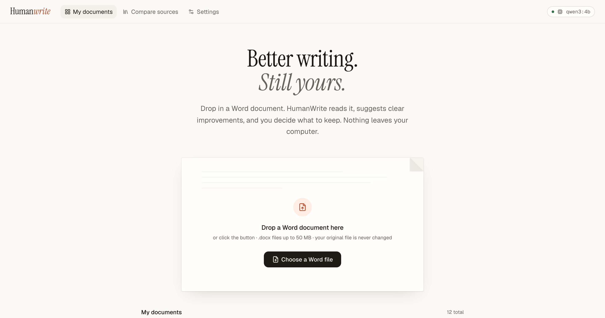
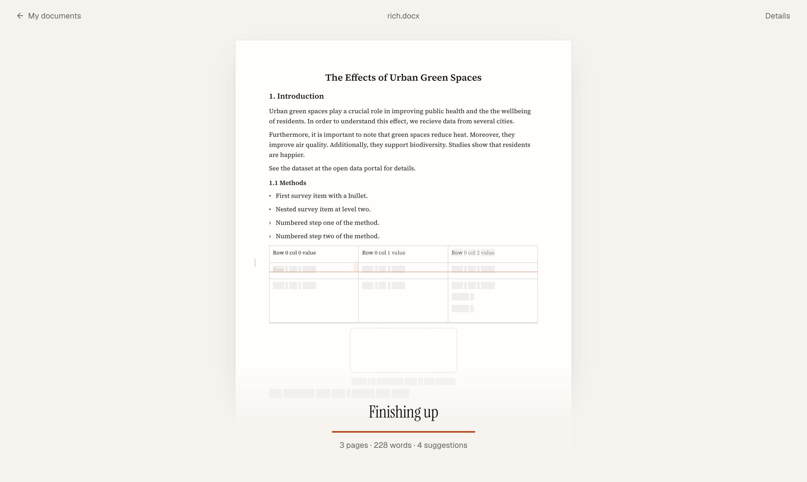
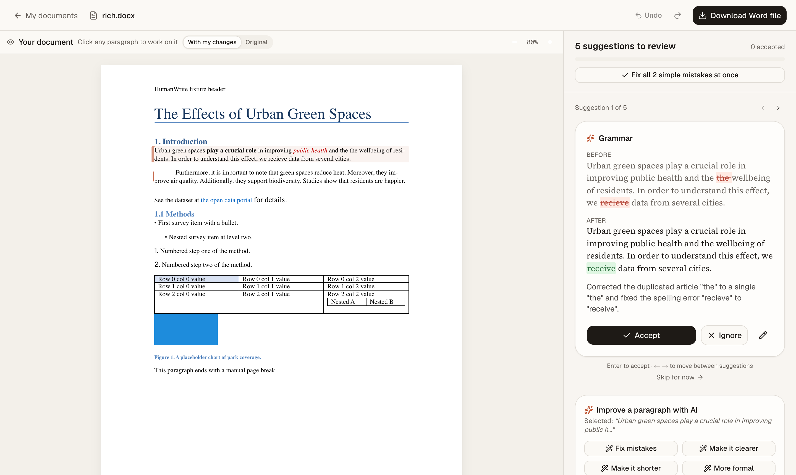

<div align="center">

# Human*write*

**Better writing. Still yours.**

A free, open-source app that reads your Word document, suggests clear improvements, and lets you decide what to keep. Everything runs on your own computer.



</div>

---

## What it does

1. **Drop in a Word file** (`.docx`).
2. **HumanWrite reads it** and checks spelling, grammar, wordiness, repetition, readability, citations and originality. It can also estimate **how much of the text looks AI-generated**.
3. **You review suggestions one at a time** and choose **Accept**, **Ignore** or **Edit**. A preview of your real document updates as you go.
4. **Ask the AI to improve any paragraph.** Use one click for "Fix mistakes", "Make it clearer", "Make it shorter" or "More formal", or type what you want in your own words.
5. **Download the improved Word file.** Fonts, bold and italics, tables, images, headers, footnotes and page layout are kept. Your original file is never changed.

### Private by design

- Your documents **never leave your computer**.
- The AI runs locally through [Ollama](https://ollama.com). There are no accounts, no subscriptions and no cloud AI.
- An optional online source search is **off by default** and clearly explained before you turn it on.

---

## Install (about 10 minutes, once)

You need a Mac, Linux or Windows computer. A Mac with Apple Silicon and 16 GB of memory works best for the AI features. You'll install three free programs, then HumanWrite.

### Step 1 — Install the three programs

<details open>
<summary><b>macOS</b></summary>

1. Open the **Terminal** app (press `⌘ Space`, type *Terminal*, press Enter).
2. If you don't have [Homebrew](https://brew.sh), install it by pasting the command shown on brew.sh.
3. Paste this and press Enter:
   ```bash
   brew install python@3.13 node git ollama
   brew services start ollama
   ```
</details>

<details>
<summary><b>Windows</b></summary>

Install these from their websites, accepting the default options:
- Python 3.13: https://www.python.org/downloads/ (tick **"Add Python to PATH"**)
- Node.js (LTS): https://nodejs.org/
- Git: https://git-scm.com/download/win
- Ollama: https://ollama.com/download

Then use **Git Bash** (installed with Git) for the commands below.
</details>

<details>
<summary><b>Linux</b></summary>

Install Python 3.12–3.14, Node.js 20+ and Git with your package manager. Then install Ollama:
```bash
curl -fsSL https://ollama.com/install.sh | sh
```
</details>

### Step 2 — Download the AI model (about 2.5 GB, once)

```bash
ollama pull qwen3:4b
```

You can skip this. HumanWrite still checks spelling, grammar and style without it; you just won't get AI rewrites. You can also download the model later from **Settings** inside the app.

### Step 3 — Get HumanWrite and start it

```bash
git clone https://github.com/YOUR-USERNAME/humanwrite.git
cd humanwrite
./start.sh
```

The first start takes a minute or two while it sets itself up. Your browser then opens at **http://127.0.0.1:3000**. That's the app.

**Next time,** open a terminal and run:
```bash
cd humanwrite
./start.sh
```

To stop HumanWrite, press `Ctrl + C` in the terminal.

---

## Using HumanWrite

| | |
|---|---|
| **1. Upload** | Drag a `.docx` file onto the page, or click **Choose a Word file**. |
| **2. Wait a moment** | You'll see your document being read. It takes a few seconds for most documents. You can leave the page; it keeps working. |
| **3. Review** | Click **Review suggestions**. For each one, press **Accept** (or the Enter key), **Ignore**, or ✎ to edit it yourself. Use ← → to move between suggestions. **Fix all simple mistakes at once** accepts every spelling, grammar and punctuation fix in one go. |
| **4. Improve with AI** | Click any paragraph in your document, then pick **Fix mistakes**, **Make it clearer**, **Make it shorter** or **More formal**, or type a request like *"make it friendlier"*. The text appears as the AI writes it, and you still decide whether to accept it. |
| **5. Download** | Click **Download Word file**. You get a new file named `… (HumanWrite revised).docx`. Your original stays exactly as it was. |

Made a mistake? Use **Undo** at the top. **Original / With my changes** at the top of the document lets you compare versions.

<p align="center">
  
  
</p>

### Optional extras

- **AI detection:** an overall AI-generated percentage, a passage-by-passage breakdown, and highlighting in your document. It's off until you turn it on in Settings.
- **Full report:** a detailed breakdown of writing quality, readability, citations, originality and writing patterns.
- **Compare sources:** add PDFs or Word files (articles, earlier drafts). HumanWrite then flags passages in your document that closely match them, so you can quote or cite properly. It compares only against what you add; it is not Turnitin.
- **Advanced editor:** a three-panel editor for power users, with search, filters, alternative AI versions and per-paragraph history.
- **Humanizer** (top menu): paste text or upload a TXT, Markdown, Word, PDF or image (OCR, Mac only) file and rewrite stiff, repetitive or generic writing into clear, natural prose. See [Humanizer](#humanizer) below.

### Humanizer

1. **Paste or upload your text.** Headings (`# Title`), lists (`- item`), quotations, citations, links and code are kept exactly as they are.
2. **Choose a mode:** Natural, Conversational, Academic, Professional, Simple English, Personal, or Custom (describe the style yourself). Then pick an **intensity**: Light, Medium or Extensive.
3. **Optional:**
   - **Variations:** up to three rewrites, each with its own approach (Balanced, Restructured, Concise, Flowing).
   - A **writing profile** learned from samples of your own writing.
   - Document type, audience, extra instructions, and the AI meaning check, under **Options**.
4. **Press Humanize** (or ⌘↵). The rewrite runs in separate steps, and the progress panel shows each one as it actually runs:
   - **Understanding meaning.** It records the qualifiers ("roughly", "may", "not necessarily"), negations, requests and logical links in each paragraph. At Medium and Extensive, the model also lists the points each paragraph makes; points it can't find in your text are discarded.
   - **Restructuring** sentences and paragraphs, section by section.
   - **Vocabulary, style, and grammar & flow.** Each of these first checks every paragraph and sends only the ones with problems back to the model, with the exact fixes to make. An edit is kept only if it passes safety checks: nothing protected changed, no new meaning problem, no added sentences, and the problem actually fixed.
   - **Validating & repairing.** Every changed paragraph is checked against your original. A paragraph with a meaning problem gets one targeted repair and is checked again. If a number, date, citation, quotation or link is still wrong after that, the paragraph is kept as you wrote it.
5. **Review.**
   - Compare inline or side by side, word by word or sentence by sentence.
   - Step through the changes with ← →, and accept (A) or reject (R) each one. Rejecting puts your original wording back.
   - **What each stage did** lists, for every step, what it found, what it fixed and what it rejected, plus how many model calls and tokens the run used.
   - With several variations, **Compare & combine** shows them side by side, paragraph by paragraph. Pick the best version of each paragraph (or keep your original), edit any pick, and create a combined version. The combined version is checked against your original again.
   - Use **Edit text** to change anything yourself. Select a sentence or paragraph and ask to *Improve*, *Improve clarity*, *Simplify*, *Improve flow*, *Shorten*, *Expand*, *Rephrase*, *Reduce redundancy*, *Change tone* (formal, friendly, confident and more), or follow a custom instruction. **Show 3 alternatives** gives you different versions to choose from.
   - Undo and redo work everywhere.
   - Download the result as Word, Markdown or plain text.

**What it won't do.**
- It never changes your original text. Every run becomes a separate version you can switch back to.
- It doesn't invent facts or citations, and it rejects any rewrite that would alter a quotation or citation.
- It doesn't try to beat AI detectors. The app's AI detector is a separate tool: you can run it on the result from **⋯ → Check with AI detector**, and the humanizer never sees the score.

**Meaning check.** Every changed paragraph is checked automatically for:
- missing or changed numbers and times (compared as whole values, so "02:00" → "00:02" is caught), dates, citations, quotations, links, names and key terms;
- dropped qualifiers ("roughly 30 minutes" → "30 minutes"; "should" → "must") and lost or added negations;
- points from the meaning map that went missing, and sentences that add something your text doesn't say;
- large cuts.

With **AI meaning check** on, the model also compares each rewritten section with the original, using the points it mapped. Problems are repaired where possible, and the rest are listed for you to review. These checks catch common problems but can't prove the meaning is identical.

**Privacy.** Text goes only to your local Ollama, and the humanizer doesn't save your input or results. Writing profiles store only derived style information (statistics, a description, traits and short expressions), never your samples, and you can delete them in the profile manager.

**Speed.** Measured on an Apple Silicon Mac with `qwen3:4b-instruct-2507-q4_K_M` (Fast speed, AI meaning check on): a 140-word e-mail took about 15 s, 180-word passages 35–40 s, and a 700-word document with four sections about 3 minutes. Three variations of a 190-word text took about 2 minutes. Each run uses 4–10 model calls, because the vocabulary, style, grammar and repair steps only call the model for paragraphs that need it. **Thorough** lets `qwen3:4b` reason before the main rewrite and the meaning check, which is much slower; the targeted edits still use the fast model.

---

## Common questions

**Is it really private?**
Yes. Documents, suggestions and edits are stored only in the `backend/data/` folder on your computer, and the AI runs locally. The only network use is downloading AI models when you choose to, and the optional source search, which is off by default.

**The app says "The AI assistant is off".**
Make sure Ollama is installed and running: open the Ollama app, or on macOS run `brew services start ollama`. Also make sure you've downloaded a model with `ollama pull qwen3:4b`. HumanWrite picks it up automatically.

**Will my formatting survive?**
HumanWrite edits the text inside your existing Word file instead of rebuilding it, and checks the result before you download it. A few things are protected and can't be edited by HumanWrite: footnote markers, images, fields such as page numbers or tables of contents, and equations. Text inside text boxes isn't edited. For important documents, open the result in Word and give it a quick look.

**Does it detect AI-written text?**
Yes, optionally. Turn on **Settings → AI detection** (a one-time download of about 2.2 GB). After that, each document shows a percentage such as *"38% AI-generated"*, a separate *"possibly AI"* share for borderline passages, and highlights in your document. Detection runs on your computer: two open classifiers, [Fakespot RoBERTa](https://huggingface.co/fakespot-ai/roberta-base-ai-text-detection-v1) (Apache-2.0) and [Desklib DeBERTa-v3](https://huggingface.co/desklib/ai-text-detector-v1.01) (MIT), read every passage, and a small layer trained by HumanWrite combines them. That layer is what makes technical answers and notes work: off-the-shelf detectors caught under 10% of AI-written technical notes.

Measured on passages the detector never saw during training:

| | Result |
|---|---|
| AI essays and articles (ChatGPT, Claude, Qwen) | ~99–100% caught |
| AI text reworded "like a student would" | 100% caught |
| AI text prompted to sound human | 100% caught |
| Current-generation AI technical answers / notes | ~92% caught |
| Human essays | ~4–5% wrongly flagged |
| Human technical answers (Stack Exchange, pre-2021) | ~0–4% wrongly flagged |
| Human research abstracts (arXiv, pre-2021) | ~2–5% wrongly flagged |

Details, data sources and the training scripts are in `DEVELOPMENT_LOG.md` and `backend/scripts/detector/`. Results from different detectors (including hosted ones) often disagree on the same document; none of them, this one included, can prove who wrote something.

No AI detector is perfect. Very formal or formulaic writing, writing by non-native English speakers, short passages and heavily edited AI text are the hardest cases. Use the result as an indicator, not as proof of who wrote something.

**Which documents work?**
Modern Word files (`.docx`). Old `.doc` files and password-protected documents need to be re-saved as a normal `.docx` in Word first.

**The AI is slow.**
`qwen3:4b` is a *reasoning* model: before writing, it thinks the task through (you'll see "Thinking it through…"). On a 16 GB Apple Silicon Mac that took about 35–40 seconds per paragraph in testing, at roughly 35–40 words per second once it writes. For much faster suggestions with the same size and memory, run `ollama pull qwen3:4b-instruct-2507-q4_K_M` and choose it in **Settings → AI assistant**. Spelling, grammar and style checks are always instant.

**Which AI model should I use?**
`qwen3:4b` is careful but slow because it reasons first. `qwen3:4b-instruct-2507-q4_K_M` is the same size and much faster. `gemma3:4b` writes nicely too. `qwen3:8b` is better but slower and needs more memory. You can switch in **Settings**.

**Can I use Docker for Ollama?**
On Linux, yes. On Macs, Docker can't use the graphics chip, so the AI runs several times slower; use the normal Ollama app instead. If you still want Docker, see `docker-compose.ollama.yml`.

---

## For developers

### Stack

| | |
|---|---|
| Frontend | Next.js 16 (App Router), TypeScript, Tailwind CSS 4, shadcn/ui (Base UI), Motion, docx-preview |
| Backend | Python, FastAPI, lxml (direct OOXML editing), python-docx (validation), SQLite, pypdf, numpy |
| AI | Ollama HTTP API: streaming chat, JSON-schema output, embeddings |
| AI detection | Optional: PyTorch + Transformers (`requirements-detector.txt`, installed from Settings), Fakespot RoBERTa + Desklib DeBERTa-v3 classifiers, combined by a trained layer (`layer_v3.json`) |

### Run manually

```bash
# backend
cd backend
python3 -m venv .venv && .venv/bin/pip install -r requirements.txt
.venv/bin/uvicorn app.main:app --reload --port 8000

# frontend (second terminal)
cd frontend && npm install && npm run dev
```

The API docs are at http://127.0.0.1:8000/docs.

**Environment variables:**
- `HUMANWRITE_DATA_DIR`: where data is stored; default `backend/data`.
- `OLLAMA_HOST_URL`: default `http://127.0.0.1:11434`.
- `HUMANWRITE_MAX_UPLOAD_MB`: default 50.
- `NEXT_PUBLIC_API_URL`: default `http://127.0.0.1:8000`.
- `HUMANWRITE_CORS_ORIGINS`: extra allowed browser origins, comma-separated (for example, a second frontend on another port).

### Tests

```bash
cd backend && .venv/bin/python -m pytest -q
cd frontend && npm test && npx tsc --noEmit && npx eslint . && npm run build
```

The backend tests generate realistic `.docx` fixtures, covering mixed formatting, nested tables, images, hyperlinks, footnotes, lists, section breaks, headers and footers, and a 400-paragraph document. Using those, they verify that:

- exports without edits are byte-identical;
- edits keep run formatting, hyperlinks and footnote markers;
- unsafe edits are refused rather than applied;
- the full API workflow runs from upload to export, including streaming and cancelling AI generation.

The AI paths are tested against a small Ollama-compatible stand-in server, so no model download is needed.

### How formatting is preserved

- **Nothing is rebuilt.** The original `.docx` is stored read-only and never rebuilt. Paragraph IDs are derived from each paragraph's position in the original XML, so they stay stable.
- **Edits go into existing runs.** Every visible character maps back to its XML run. Edits are applied with a word-level diff into those runs, so new text inherits the formatting around it. Footnote markers, images, fields and equations are protected.
- **Only changed parts are rewritten.** On export, only XML parts that contain changed paragraphs are rewritten. Everything else (media, styles, relationships) is copied byte-for-byte.
- **Every export is checked before it's offered for download:**
  - the package structure is valid;
  - media, relationships and styles are unchanged;
  - re-extracted text matches every approved edit;
  - paragraph properties are untouched;
  - the file opens in python-docx.
- **The preview is the export.** The live preview is the real export with invisible bookmarks added, rendered in the browser, which is how clicking the preview maps back to paragraphs.

### Project layout

```
backend/app/
  api/          HTTP endpoints (documents, suggestions, revisions, export, settings, Ollama, corpus)
  workers/      processing pipeline (resumable, cancellable, emits live events)
  events/       persisted Server-Sent Events
  services/
    ooxml/        text model + format-preserving paragraph editor
    extraction/   DOCX parser, sentence splitter, optional macOS OCR
    export/       package-preserving export + validation
    analysis/     writing rules, readability, writing patterns, citations
    detection/    optional local AI-text detector (classifier + calibration)
    plagiarism/   fingerprints, corpus index, similarity, optional OpenAlex/Crossref
    writing/      prompts, suggestions, revision log, meaning checks
    humanizer/    multi-stage rewriting engine: pipeline (stages + variations), semantics (meaning ledger, semantic map),
                  refine (vocabulary/style/grammar checks + edit guard), validation (+ repair triggers), blocks + protection,
                  writing analysis, prompts, LLM wrapper (tiers, retries, token usage), style profiles, file
                  extraction/export, selection rewriting
    ollama/       Ollama client
frontend/
  app/          pages: home, scan, review, advanced editor, report, export, sources, settings
  components/   review/, scanning/, editor/, document-preview/, analysis/, settings/, …
```

### Known limitations

- **Tracked changes:** existing tracked changes aren't fully preserved, and edits are exported as direct changes rather than tracked changes.
- **Text boxes and shapes:** text inside them isn't analysed or edited.
- **Page numbers are estimates** unless Word saved page-break positions in the file.
- **Browser preview vs Word:** the preview is a close approximation of Word, not Word itself.
- **Platform testing:** developed and tested on macOS with Apple Silicon. Linux and Windows should work, but haven't been tested. OCR of images inside documents uses Apple's Vision framework and is macOS-only.

See [DEVELOPMENT_LOG.md](DEVELOPMENT_LOG.md) for the build history.

---

## Contributing

Contributions are very welcome; see [CONTRIBUTING.md](CONTRIBUTING.md). Good first areas:
- more writing rules and languages;
- Windows and Linux testing;
- tracked-changes export;
- accessibility.

## License

[MIT](LICENSE). Free to use, change and share.
